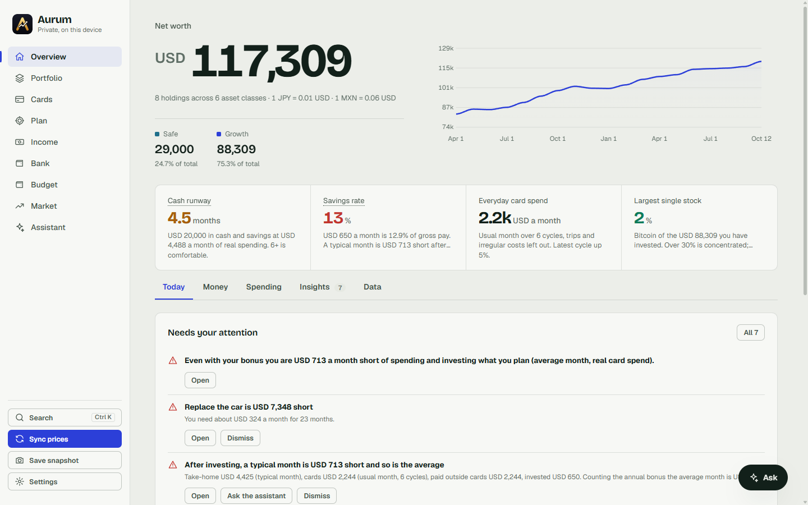
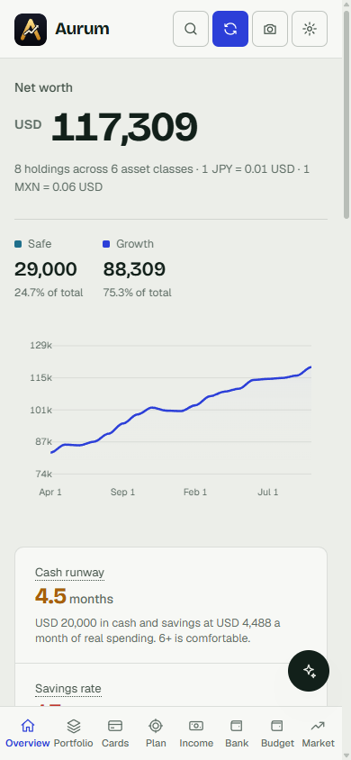
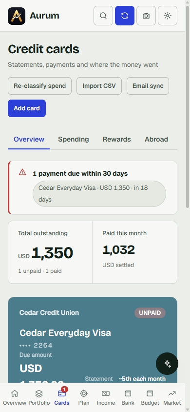
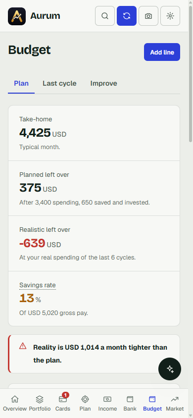

# Aurum

**Your net worth, cards, budget and plan in one private place. It runs on your own computer; nothing is uploaded to anyone.**

**Docs and screenshots: <https://abxhr.github.io/aurum/>**



<p align="center">  </p>

*All screenshots come from the built-in demo: an invented person, banks and merchants, in US dollars. No real data is in this repository.*

## What it does
* **Net worth** across cash, savings, funds, shares, bonds, gold and crypto, live-priced, with history and a safe-versus-growth split.
* **Cards**: statements are read from your e-mail, sorted into categories and trips, and checked for fees, rewards and exchange-rate markup.
* **Plan**: emergency fund, dated goals, free money to invest, projections and a staged-buying plan from your real income and spending.
* **Income, Bank, Budget**: payslips and bank statements read from PDF; planned versus actual spending.
* **Market**: daily briefing, buy-timing backtests, watchlist signals. It never predicts and never trades.
* **Assistant**: Claude or GPT with tools over your own data. It can only research and *propose*; every change is a card you approve.
* **Any currency**: choose yours at first run (Settings > Currency).
* **Private**: local-only server, strong password, Face ID on your phone via Tailscale, encrypted secrets, strict CSP/CSRF, tested.

Flask + SQLite + vanilla JS. No framework, no analytics, no third-party requests from the page (fonts, charts and QR codes are vendored).

## Quick start
Needs Python 3.11+ and Git.

```bash
git clone https://github.com/abxhr/aurum.git aurum
cd aurum
./run.sh        # Windows: run.bat
```
Open <http://localhost:5000>, choose a password and your currency. Or press **Open the demo instead** to look around with invented data. Full guide: [Set up](https://abxhr.github.io/aurum/setup.html).

| Guide | |
|---|---|
| [Set up](https://abxhr.github.io/aurum/setup.html) | install, currency, background service, backups, troubleshooting |
| [Integrations](https://abxhr.github.io/aurum/integrations.html) | Gmail statements, Interactive Brokers, eToro, AI keys |
| [Phone](https://abxhr.github.io/aurum/phone.html) | Tailscale, Face ID, Home Screen, alerts |
| [Security](https://abxhr.github.io/aurum/security.html) | threat model, protections, your responsibilities |

The same pages are plain HTML in [`docs/`](docs/) (GitHub Pages serves them from `main` / `docs`).

## Any bank, card or payslip
Aurum does not know your bank in advance. Statements come in three ways: a **CSV import** (cards and bank accounts), **e-mailed PDFs** read by a generic reader (a line that starts with a date and ends with an amount; labelled totals; sign convention worked out per file), and, for a layout that defeats both, a small **private parser plugin** in `data/parsers/` that is git-ignored and never leaves your computer. Interactive Brokers and eToro connect read-only from Settings. See [Any bank](https://abxhr.github.io/aurum/banks.html).

Honest limits: image-only or scrambled PDFs cannot be read generically (use a CSV); prices, rates and market data come from Yahoo Finance; changing currency relabels existing amounts, it does not convert them, so choose it before entering data.

## Data and secrets
Everything is in `data/` (git-ignored): one SQLite file, plus `secrets.key` on macOS/Linux. API keys and passwords you enter are sealed (Windows DPAPI, or Fernet elsewhere) and never sent back to the browser. A new install starts empty. `backend/test_repo_clean.py` fails if any key, token or personal address would be committed; CI runs it.

## Tests
```bash
python backend/test_security.py     # sign-in, CSRF, rebinding, Face ID flow, sealed secrets, backups
python backend/test_basics.py       # planner and budget arithmetic
python backend/test_categorizer.py  # spending categorisation
python backend/test_parsers.py      # generic statement/CSV/payslip readers and the plugin hooks
python backend/test_repo_clean.py   # no keys, tokens or personal addresses
```

## Contributing, security, license
See [CONTRIBUTING.md](CONTRIBUTING.md). Report vulnerabilities privately: [SECURITY.md](SECURITY.md). [MIT](LICENSE). Not financial advice.
